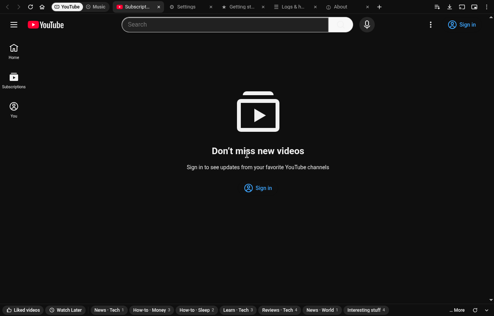
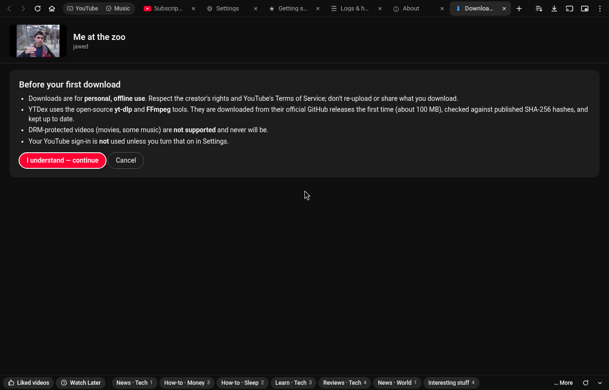
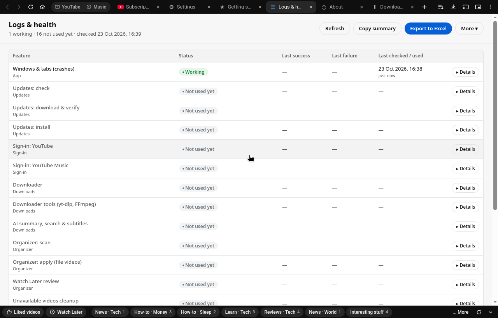
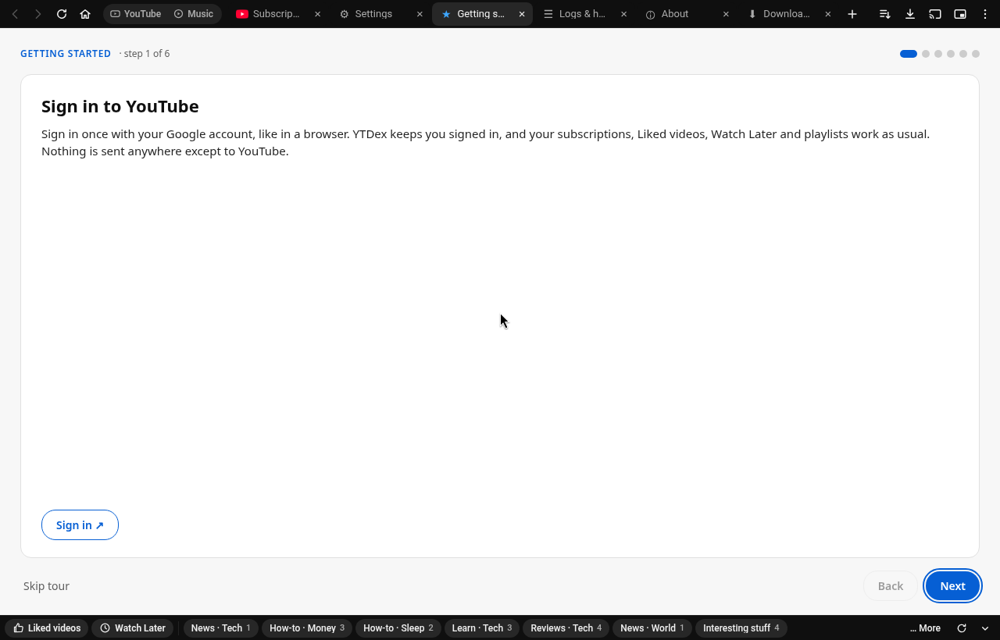
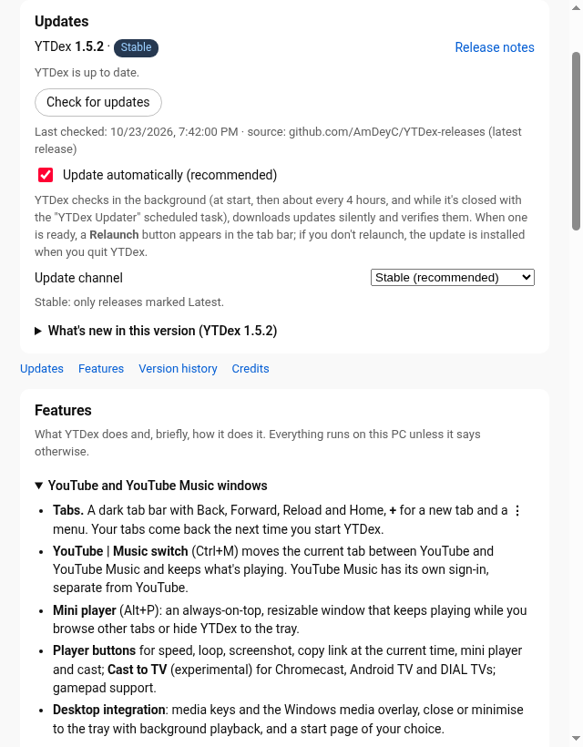

  

<h1 align="center">YTDex</h1>

  A Windows desktop app for watching videos and listening to music, with tabs, a mini player, ad and sponsor skipping,
  offline saving and a playlist organizer that runs on your PC.

  

  Latest version · Windows 10 and 11 · 64-bit and 32-bit · free 
  An independent, unofficial app.

  

---

## What it does

### Watching
- **Videos and music in one window.** Open as many tabs as you like. A **Videos | Music** switch (Ctrl+M)
  moves a tab between the two and keeps what is playing. Music can use its own sign-in or share the same one.
- **Mini player.** An always-on-top, resizable window keeps playing while you browse other tabs or hide YTDex (Alt+P).
- **Fewer interruptions.** Built-in ad and tracker blocking, and **SponsorBlock** skips or marks sponsor segments,
  intros and reminders. You choose per category: skip, show a button, highlight or off.
- **Player extras.** Default quality and speed, loop, screenshot, copy link at the current time, dislike
  counts, hide Shorts, end screens and info cards, optional DeArrow titles and thumbnails.
- **Desktop touches.** Media keys and the Windows media overlay, tray and background playback, gamepad support and
  (experimental) casting to a TV.

### Saving videos for offline use
- A **Download** button under the video, in the player bar and on playlist pages saves video (up to 8K, MP4, WebM or
  MKV) or audio (MP3, M4A or Opus) with subtitles, thumbnail and chapters. It uses the open-source yt-dlp and FFmpeg
  tools, fetched on first use and checked against published hashes. Meant for personal offline viewing where the
  creator and the site's terms allow it.

### Organizing your library (when signed in)
- **Organizer for Liked videos and Watch Later.** One **Scan** sorts them into your playlists, or new private ones
  such as *Learn · Programming*. Each suggestion says why. Nothing moves until you review it, every change is checked
  and **Undo last run** puts things back.
- **It learns.** It uses your existing playlists as examples and remembers your corrections. An optional on-device
  model helps with unclear titles. What you watch stays on your PC.
- **Unavailable-video cleanup.** After a scan it finds deleted, private and removed videos in the lists you scanned and can
  remove them for you.
- **Quick-access bar.** A slim bar at the bottom takes you to Liked videos, Watch Later and your playlists in one click,
  with live counts (F6 to reach it from the keyboard).

### Looking after itself
- **Automatic updates.** New versions download quietly and install when you click **Relaunch** or the next time you
  quit. If an update fails to start twice, YTDex goes back to the previous version by itself.
- **Settings transfer.** Export your settings, organizer rules and categories to a `.ytdex` file and import them on
  another PC.
- **Logs & health.** A plain-language page that shows which features are working, what went wrong and when, with an
  export for bug reports.

  
  
   
  
  

## Install

1. Download **YTDex-Setup-&lt;version&gt;.exe** from the [latest release](https://github.com/AmDeyC/YTDex-releases/releases/latest).
   It installs the right build for your PC. There are separate `-x64` (64-bit) and `-x86` (32-bit) setups too.
2. Run it. You can install for yourself only (no admin needed) or for all users.
3. **Windows SmartScreen:** YTDex is not code-signed yet, so Windows may show *"Windows protected your PC"*.
   Click **More info → Run anyway**.

After that YTDex keeps itself up to date. A setup for a newer version also installs over an older one and keeps your
sign-ins, settings and downloads.

### System requirements
- Windows 10 or Windows 11, 64-bit or 32-bit (ARM64 PCs run the 64-bit build)
- About 500 MB of free disk space, plus room for anything you save
- An internet connection

## FAQ

**Is it free?** Yes.

**Do I have to sign in?** No. Watching works signed out. Signing in (in the app, on the official sign-in page) is needed for
your subscriptions, Liked videos, Watch Later, playlists and the organizer.

**Does it change my account?** Only when you ask it to: the organizer adds and removes videos in your playlists
after you review the changes, and can undo its last run. Playlists are never deleted.

**Why does my antivirus or SmartScreen warn about it?** New, unsigned apps often get a warning until they build up a
reputation. If your antivirus quarantines it, please report it.

**Where are my settings?** In `%APPDATA%\YTDex`. Uninstalling asks whether to keep them (kept by default).

**How do I report a problem?** Open **Help › Logs & health**, export the log, and attach the file to an
[issue](https://github.com/AmDeyC/YTDex-releases/issues).

## Privacy
- No YTDex account, no analytics, no telemetry. YTDex has no server of its own and collects nothing about you.
- Your sign-in stays in the app's own browser profile on your PC.
- It contacts the video site itself, GitHub (for updates and the yt-dlp/FFmpeg tools), and, while those features are on,
  SponsorBlock and DeArrow (asked with a short hash prefix, not the video ID) and the dislike-count service (asked with the
  video ID).
- The organizer's optional cloud AI is off by default. It uses your own key and only runs when you press *Ask cloud AI*.
  Then it sends only the titles, channel names and the start of the descriptions of the unclear videos, plus your playlist names.

## Credits
YTDex grew out of [the original desktop app](https://github.com/mikepruett3/youtube-desktop) by **Mike Pruett**. Thanks to him
and to the projects it builds on: Electron, Ghostery adblocker, SponsorBlock, Return Dislike, DeArrow,
yt-dlp, FFmpeg and onnxruntime.

## Legal
YTDex is an independent, unofficial app and isn't affiliated with, endorsed by or sponsored by any video or music
service. All trademarks belong to their owners. Please respect creators and each site's terms of service.
